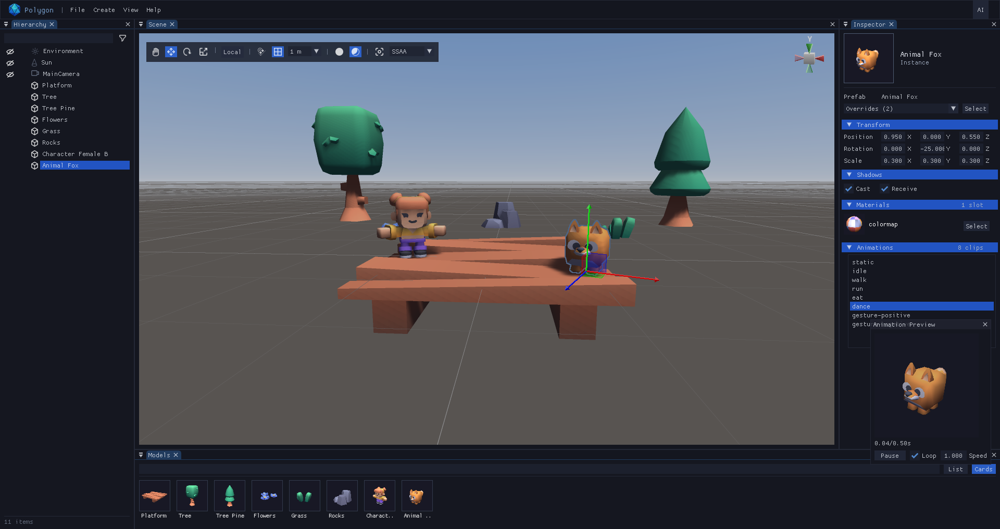

# Polygon

**A 3D in-game scene editor for GameMaker, built on GM3D and Dear ImGui.**


Polygon opens inside your running game (press **F1** in the demo), mirrors the live scene, and lets you place, transform and inspect objects. Scenes are saved to JSON and can be loaded back at runtime with a single call.




## Features

**Editing**
- Drag models from the **Models** panel into the viewport (live drop preview)
- Move / Rotate / Scale gizmos with axis, planar and trackball handles, World or Local space, Pivot or Center handles
- Position, rotation and grid snapping (hold **Ctrl** for temporary snap)
- Multi-selection: click, Shift+click, rubber-band rectangle, and depth cycling on repeated clicks
- Duplicate, delete, rename, focus, and **undo/redo**
- Hide / lock objects per node

**Scene content**
- Models (prefabs) with per-asset spawn defaults (rotation, scale, shadows)
- Lights (directional, point), cameras (perspective, ortho) and an environment volume (ambient, fog)
- Prefab overrides with per-field **Revert / Apply**
- Read-only inspection of materials, textures (with sampler state) and animation clips, including a playable animation preview

**Viewport**
- Dockable windows: Hierarchy, Inspector, Models, Scene, Toolbar
- Orientation **ViewCube**, infinite grid, procedural sky
- Selection outline (GPU mask), GPU ID-buffer picking
- Shaded / Unlit draw modes, antialiasing: Off, FXAA, SMAA (default), SSAA

**Workflow**
- JSON scene files (versioned format) with save / load / delete dialog
- Unsaved-changes confirmation
- Optional **AI bridge** (MCP relay) to drive the editor from an AI client

---

## Requirements

- GameMaker with **GMRT** package v0.22.4

---

## Installation

1. Import the resources into your project by dragging the `editor.yymps` file into your project.
2. Create `oEditor` in your game using the setup below.

---

## Quick start

Polygon only needs a small **config** struct. It never touches your game instances: it works on its own copy of the scene.

```gml
// oGame / Create
var assets = {};
assets[$ "models/tree.glb"] = { model: my_model_a };
assets[$ "models/rock.glb"] = { model: my_model_b, on_create: my_rock_setup };

var config = {
  scene: my_scene,          // your live GM3D_Scene (mirrored on enable)
  cam: my_camera_node,      // your gameplay camera node (seeds the editor view)
  on_create: my_on_create,    // optional: called for every spawned node
  on_close: my_on_close,    // optional: called when the editor closes
  on_compose: my_on_compose,  // optional: viewport post-processing hook
  assets,           // struct keyed by asset id: { model, on_create? }
};

instance_create_layer(0, 0, layer, oEditor, { config });
```

Wire the `oEditor` events:

| Event               | Code                |
|---------------------|---------------------|
| Create              | `poly_create(config); poly_enable();` |
| Step                | `poly_step();`   |
| Draw                | `poly_draw();`   |
| Draw GUI            | `poly_draw_ui();`|
| Async Networking    | `poly_ai_net();` |
| Clean Up            | `poly_cleanup();`|

Toggle the editor from your game:

```gml
// oGame / Key Press F1
if (!poly_is_active()) poly_enable();

// pause your own world while the editor is open
if (!poly_is_active()) my_game_step();
```

Close it from the editor with **File → Close Editor** (Ctrl+W).

### Adapter fields

| Field      | Description |
|------------|-------------|
| `scene`    | Live scene. On every enable, Polygon imports it (see below). |
| `cam`      | Gameplay camera node, used to seed the editor camera. |
| `assets`   | Struct `{ assetKey: { model, on_create? } }`. The key is the stable asset id used in scene files (usually the load path); the file name (no path, no extension) is used as display text everywhere. `on_create` is an optional per-model hook, called after the global one. |
| `on_create` | `function(node, assetId, model, id)`. Called for every spawned node: global hook first, then the per-model `on_create` from the library entry. `assetId` is the stable key (same string as in files); `model` is the resolved library model. Walk the subtree: the model root lives inside the wrapper. |
| `on_close` | Called after the editor closes. |
| `keys`     | Optional struct that remaps editor shortcuts. Each entry is an array of element structs `{ key, mouse?, modifier? }`, e.g. `save: [ { key: vk_control, modifier: true }, { key: ord("S") } ]` and `cam_fly: [ { key: mb_right, mouse: true } ]`. Every shortcut and camera control is remappable, including nudging and the mouse-driven camera gestures. Unknown names are ignored. See "Remapping shortcuts". |
| `on_compose` | `function(surf, w, h)`. Optional viewport post-processing: called with the scene surface as target, after the 3D render (post-AA) and before overlays compose (they stay sharp). Copy `surf` to your own scratch, apply your shader back onto `surf`, and leave the target on `surf`. Runs on re-render, not every frame. |

---

## Using the editor

### Camera

| Action | Input |
|--------|-------|
| Fly | Hold **Right mouse** + `W A S D`, `Q` / `E` for down / up |
| Fly faster | Hold **Shift** |
| Change fly speed | Mouse wheel while flying |
| Orbit | **Alt + Left mouse** |
| Zoom | Mouse wheel, or **Alt + Right mouse** drag |
| Pan | **Middle mouse** (or drag with the View tool) |
| Focus selection | `F` or double-click in the Hierarchy |
| Reset camera | Home button in the toolbar |
| Snap to axis | Click a cone on the **ViewCube** |

The cursor wraps at window edges during camera and gizmo drags. Every input above is remappable through the `keys` config — see "Remapping shortcuts".

### Tools and shortcuts

| Key | Action |
|-----|--------|
| `Q` `W` `E` `R` | View, Move, Rotate, Scale |
| `X` | Toggle World / Local axes |
| `Z` | Toggle Pivot / Center handles |
| `Del` | Delete selection (confirms for multiple objects) |
| `Shift+D` | Deselect all |
| `F2` | Rename instance |
| Arrow keys | Nudge selection on X/Z |
| `Esc` | Cancel the current gesture, otherwise clear selection |
| `Ctrl+S` / `Ctrl+L` / `Ctrl+N` | Save / Load / New |
| `Ctrl+D` | Duplicate |
| `Ctrl+C` / `Ctrl+X` / `Ctrl+V` | Copy / Cut / Paste (cut + paste in one undo step each) |
| `Ctrl+I` | Invert selection (locked nodes never selected) |
| `Ctrl+A` | Select all (locked nodes excluded) |
| `Ctrl+F` | Find object (focuses the Hierarchy / Models search field) |
| `Ctrl+Z` / `Ctrl+Y` (or `Ctrl+Shift+Z`) | Undo / Redo |
| `\` | Toggle snap on/off |
| `Ctrl+\` | Push selection to grid (undoable) |
| `Ctrl+W` | Close editor |
| `F9` | FPS overlay |

### Remapping shortcuts

Every editor shortcut **and camera control** is remappable through the `keys` field of the create config. Each entry is an **array of elements**, and every element is a struct that says exactly what it is — no value is ever guessed:

```gml
{ key: <code>, mouse: <bool>, modifier: <bool> }
```

- **`key`** — the code: `vk_*` constants for special keys, `ord("X")` for letters/digits, or `mb_left` / `mb_right` / `mb_middle` / `mb_side1` / `mb_side2` for mouse buttons.
- **`mouse: true`** — marks `key` as a **mouse button**. Without it the code is a keyboard key. This is what keeps a mouse button and a key with the same numeric value from ever being confused.
- **`modifier: true`** — this element must be **held**. Elements without it are **triggers**; several triggers in one array are **alternatives**. For one-shot shortcuts, any keyboard modifier you do *not* list must be **up** (exact match), so `Ctrl+S` and `Ctrl+Shift+S` stay distinct. (The GameMaker constant is `vk_control`, not `vk_ctrl`.)

A bare real — or a single struct — is shorthand for one keyboard trigger: `pivot: ord("Z")` is the same as `pivot: [ { key: ord("Z") } ]`.

```gml
var config = {
  // ...
  keys: {
    save:         [ { key: vk_control, modifier: true }, { key: ord("S") } ],  // Ctrl+S
    load:         [ { key: vk_control, modifier: true }, { key: ord("L") } ],  // Ctrl+L
    close:        [ { key: vk_control, modifier: true }, { key: ord("W") } ],  // Ctrl+W
    focus:        [ { key: ord("F") } ],                                       // F   (focus selection)
    focus_search: [ { key: vk_control, modifier: true }, { key: ord("F") } ],  // Ctrl+F (search panel)
    deselect:     [ { key: vk_shift, modifier: true }, { key: ord("D") } ],    // Shift+D
    del:          [ { key: vk_alt, modifier: true }, { key: vk_delete } ],     // Alt+Del
    snap:         [ { key: 92 }, { key: 220 } ],                               // \ (either code), no modifier
    pivot:        ord("Z"),                                                    // Z (short form)

    // Mouse buttons are declared explicitly with mouse: true.
    nudge_left:   [ { key: vk_left } ],                                        // Left arrow
    select_add:   [ { key: vk_shift } ],                                       // Shift (Shift+click / rect add)
    cam_fly:      [ { key: mb_right, mouse: true } ],                          // hold Right mouse to fly
    cam_forward:  [ { key: ord("W") } ],                                       // W A S D while flying
    cam_orbit:    [ { key: vk_alt, modifier: true }, { key: mb_left, mouse: true } ],  // Alt + Left mouse
    cam_zoom:     [ { key: vk_alt, modifier: true }, { key: mb_right, mouse: true } ], // Alt + Right mouse
    cam_pan:      [ { key: mb_middle, mouse: true } ],                         // Middle mouse
    cam_boost:    [ { key: vk_shift } ],                                       // Shift = fly faster
  },
};
```

Binding names and their defaults (`mod` below means `{ modifier: true }`):

| Name | Default | Name | Default |
|------|---------|------|---------|
| `tool_view` | `[Q]` | `save` | `[mod Ctrl, S]` |
| `tool_move` | `[W]` | `dupe` | `[mod Ctrl, D]` |
| `tool_rotate` | `[E]` | `copy` | `[mod Ctrl, C]` |
| `tool_scale` | `[R]` | `cut` | `[mod Ctrl, X]` |
| `del` | `[Del]` | `paste` | `[mod Ctrl, V]` |
| `deselect` | `[mod Shift, D]` | `invert` | `[mod Ctrl, I]` |
| `focus` | `[F]` | `select_all` | `[mod Ctrl, A]` |
| `focus_search` | `[mod Ctrl, F]` | `new_scene` | `[mod Ctrl, N]` |
| `snap` | `[92, 220]` | `close` | `[mod Ctrl, W]` |
| `snap_grid` | `[mod Ctrl, 92, 220]` | `load` | `[mod Ctrl, L]` |
| `pivot` | `[Z]` | `undo` | `[mod Ctrl, Z]` |
| `orient` | `[X]` | `redo` | `[mod Ctrl, Y]` |
| `rename` | `[F2]` | `redo_shift` | `[mod Ctrl, mod Shift, Z]` |
| `cancel` | `[Esc]` | | |
| `nudge_left` | `[Left]` | `nudge_right` | `[Right]` |
| `nudge_up` | `[Up]` | `nudge_down` | `[Down]` |
| `select_add` | `[Shift]` | `cam_boost` | `[Shift]` |
| `cam_fly` | `[mb_right]` | `cam_pan` | `[mb_middle]` |
| `cam_orbit` | `[mod Alt, mb_left]` | `cam_zoom` | `[mod Alt, mb_right]` |
| `cam_forward` | `[W]` | `cam_back` | `[S]` |
| `cam_left` | `[A]` | `cam_right` | `[D]` |
| `cam_up` | `[E]` | `cam_down` | `[Q]` |
| `gizmo_screen` | `[Shift]` | `snap_temp` | `[Ctrl]` |
| `select_range` | `[Ctrl]` | `fps` | `[F9]` |

Notes:

- The actions that share a base key have **separate names**, so each combination is independent: `focus` vs `focus_search`, `snap` vs `snap_grid`, and `redo` vs `redo_shift`.
- `nudge_*` move the selection on X/Z; `cam_*` drive the viewport camera. `select_add` is the held modifier for Shift+click / rectangle add, `select_range` the held modifier for Ctrl+click range select in the Hierarchy, `gizmo_screen` the Move-handle screen-space modifier, `snap_temp` the drag-time snap modifier, and `cam_boost` the fast-fly modifier.
- Camera movement keys (`cam_forward` … `cam_down`) and the `cam_*` buttons are matched non-exactly, so `Shift` (`cam_boost`) can be held while flying without cancelling the movement keys.
- The shortcut hints shown in the menu bar (`File`) and in the Hierarchy row context menu (`Focus`, `Rename`, `Duplicate`, `Copy`, `Cut`, `Paste`, `Delete`), plus the undo hint in the delete confirmation, are generated from these bindings, so they update automatically when you remap them.

### Selecting and transforming

- **Click** an object to select it. Click again at the same spot to cycle through overlapping objects.
- **Shift+click** toggles an object; drag on empty space for a **rectangle selection** (hold Shift to add).
- With **Move**, hold **Shift** for a screen-space move handle; the squares between axes move on a plane.
- With **Rotate**, the outer ring rotates around the view axis and the inner disc acts as a trackball.
- Hold **Ctrl** while dragging to snap, or press **`\`** to toggle snap. **Ctrl+`\`** pushes the selection onto the grid. Configure grid size and axes from the grid combo in the toolbar.
- The toolbar **Pivot/Center** toggle moves the gizmo handles between the node positions (Pivot, the default) and the center of the selection bounds (Center).
- Scale needs a uniform handle (center) or an axis handle; environment nodes cannot be transformed.

### Panels

- **Models**: filterable list or cards of your library. Drag into the viewport to place. Select one to edit its spawn defaults.
- **Hierarchy**: eye = hide, hand = lock (locked objects cannot be selected). Ctrl+click selects a range, right-click opens the context menu, rubber-band selects rows. The filter button limits types (models, lights, cameras, environment).
- **Eye menu** (toolbar, next to AA): toggle hidden-objects visibility, skybox and selection outline.
- **Inspector**: Transform, Light / Camera / Environment, Shadows, Materials, Animations. Prefab instances show an **Overrides** menu to revert or apply rotation, scale and shadow changes.

### Creating lights, cameras and environment

Use the **Create** menu: Directional Light, Point Light (up to 8 lights), Perspective Camera, Ortho Camera, Environment (one per scene). The first enabled camera is the gameplay camera; otherwise the first one is used.

### Viewport post-processing

Pass `on_compose` in the config to preview your own post-processing inside the editor viewport. It runs after the 3D render (post-AA) and before gizmo/outline overlays, so overlays are never graded:

```gml
on_compose: function(_surf, _w, _h) {
  my_scratch = my_postfx_ensure(my_scratch, _w, _h);
  surface_set_target(my_scratch);
  draw_surface(_surf, 0, 0); // snapshot (never sample _surf while targeting it)
  surface_reset_target();
  surface_set_target(_surf); // restore the editor target!
  shader_set(shMyGrade);
  shader_set_uniform_f(shader_get_uniform(shMyGrade, "u_texel"), 1 / _w, 1 / _h);
  draw_surface(my_scratch, 0, 0);
  shader_reset();
  // leave the target on _surf and GPU state as you found it
}
```

---

## Saving and loading scenes

Scenes are saved from **File → Save / Save As** into `working_directory/__PolygonEditor__/scenes/<name>.json` or `<name>.bin`. The save dialog has a **JSON / Binary** radio (no extra modal): Binary is a compact buffer format (`PLYB` magic, `buffer_*` types, no JSON inside) with the same content as JSON v1. **File → Load** shows a search + file list with one row per file (`scene.json` and `scene.bin` listed separately); `poly_load` opens either one.

Load a scene in your game, without the editor, with (always async: parse
now, spawn chunked — pump every Step, callback on completion):

```gml
// assets: same struct shape as the poly_create config
var assets = {};
assets[$ "models/tree.glb"] = { model: my_model_a };
assets[$ "models/rock.glb"] = { model: my_model_b, on_create: my_rock_setup };

var job = poly_load(my_scene, "__PolygonEditor__/scenes/level1.json", assets, my_on_create, function(_rep) {
  show_debug_message("placed: " + string(_rep.placed) + " failed: " + string(_rep.failed));
});
// undefined = missing/invalid file. The scene must outlive the load.

// oGame / Step
poly_load_step(); // advances all pending loads (~48 nodes each frame), returns pending count
// report = { placed, failed, companions, warnings, placements }
// placements = [{ node, asset, id, label, model, instance }]
```

`poly_load` spawns instances, lights, cameras and environments, preserving node ids. For every instance it calls, in order:

1. the global `on_create(node, assetId, model, id)` (4th argument, optional),
2. the per-model `on_create` from `assets[key]` (optional),
3. the companion spawn below (when configured).

### Actors

In the Models panel, selecting a model shows an **Actor** section in the Inspector. By picking a GameMaker object + layer stores a per-model binding in the scene file:

```json
{ "assets": { "models/fox.glb": { "type": "model", "actor": { "object": "oEnemy", "layer": "Actors" } } } }
```

At load, every instance of a bound model spawns a companion via `instance_create_layer(0, 0, layer, obj, { node, poly_id, poly_asset_id })` - the object reads the node from its creation variables and drives it in its own Step/Draw events. Missing objects or layers never fail the load: they become `report.warnings` entries. Layer defaults to `"Instances"`.

Bindings store the **object name**: renaming the object in GameMaker breaks the binding (the node still spawns, without companion). The Actor section flags unknown objects in red; a renamed object is fixed by re-picking it.

Kill actors only through the helper, never with `node.destroy` / `instance_destroy` directly, or the other half is left orphaned:

```gml
poly_actor_destroy(id);    // from inside the companion, or any instance id
poly_actor_destroy(node);  // from a scene node (finds the companion)
poly_actor_of(node);       // companion instance id bound to a node, or undefined
```

---

## Scene file format

```json
{
  "version": 1,
  "seq": 12,
  "assets": {
    "models/tree.glb": { "type": "model", "actor": { "object": "oTree", "layer": "Actors" } }
  },
  "nodes": [
    {
      "kind": "instance",
      "id": "__PolygonEditor__3",
      "label": "Tree",
      "assetId": "models/tree.glb",
      "transform": {
        "position": [0, 0, 0],
        "rotation": [0, 0, 0, 1],
        "scale": [1, 1, 1]
      },
      "shadows": { "cast": true, "receive": true }
    }
  ]
}
```

`kind` is one of `instance`, `light`, `camera`, `environment` (the last three carry a `light` / `camera` / `environment` sub-object). The transform lives in `transform: { position, rotation, scale }` (rotation is a quaternion `[x, y, z, w]`). Instances link their model via `assetId`. `label` is an optional custom instance name (F2 in the Hierarchy); without it, the asset file name + id number is shown. Node ids are stable and are what the AI bridge uses.

The Binary variant (`.bin`, magic `PLYB`, version 1) stores the same fields with `buffer_*` types: strings as `buffer_string`, transforms as `f32`, colors as `u8`, flags packed in bits — no JSON inside.

---

## AI bridge (optional)

Polygon can connect to a local **MCP relay** (`other/mcp-relay`, Node) so an AI client can inspect and edit the scene.

1. Install [Node.js](https://nodejs.org/en/download/archive/v24.21.0) v24.21
2. On your AI tool (eg. OpenCode, Codex, Claude Code), configure the MCP server 
pointing at the address `127.0.0.1:5192`.

    Note: If your editor does not start the server automatically, then you need to open a terminal (eg. Powershell on Windows), move inside the _mcp-relay_ folder and start it with the command: `$ node server.js`.

    If it says, that the port is already occupied, then maybe the server is already running or there is another process on that port.

3. In the editor, click the **AI** button in the menu bar. The status shows *Connecting*, *Connected* or *Reconnecting*.

Available tools (23, all prefixed `poly_`):

Inspect: `poly_get_status`, `poly_get_scene_hierarchy`, `poly_get_selection`, `poly_get_object_details`, `poly_get_assets`, `poly_raycast_down`, `poly_take_screenshot`, `poly_capture_views`, `poly_audit_overlaps`, `poly_audit_walkability`.
Edit: `poly_select_objects`, `poly_focus_object`, `poly_set_camera`, `poly_create_object`, `poly_set_transform`, `poly_rename_object`, `poly_delete_objects`, `poly_save_scene`, `poly_apply_batch`, `poly_drop_to_ground`, `poly_place_on`, `poly_set_visible`, `poly_load_scene`.

Details in [`other/mcp-relay/README.md`](other/mcp-relay/README.md).

---

## Rebuilding the asset package (maintainers)

`editor.yymps` is the importable Local Asset Package. It is generated with GameMaker's **ProjectTool** (the same tool the IDE uses behind **Tools → Create Local Package**) and contains every resource of the **Polygon Editor** folder — scripts, sprites, shaders — plus the Included Files under `datafiles/__PolygonEditor__`. The demo datafiles are stripped from the package.

```sh
# one-time: enable the checked-in hooks (runs on any npm install)
npm install

# rebuild on demand
npm run pack
```

The `pre-push` hook rebuilds the package automatically and **never blocks the push**: if GameMaker (or PowerShell) is unavailable it just pushes the previous package. When the package **content** changes it commits `editor.yymps` in its own commit so the next push ships it — a re-export always differs byte-for-byte because the zip stores timestamps, so the script compares the entries (name + MD5) rather than trusting `git status`. Skip the rebuild with `POLYGON_SKIP_PACK=1 git push`, or set `POLYGON_PROJECTTOOL` when ProjectTool is not in its default location.

## Contributing

Bug reports and feature requests: [GitHub Issues](https://github.com/manuel-di-iorio/Polygon/issues) (also reachable from **Help → Report a Bug/Feature Request**).

## License

Released under the MIT License, 2026. Developed by Emmanuel Di Iorio (Xeryan). Third-party assets (e.g. the Kenney models used in the demo) belong to their owners.
